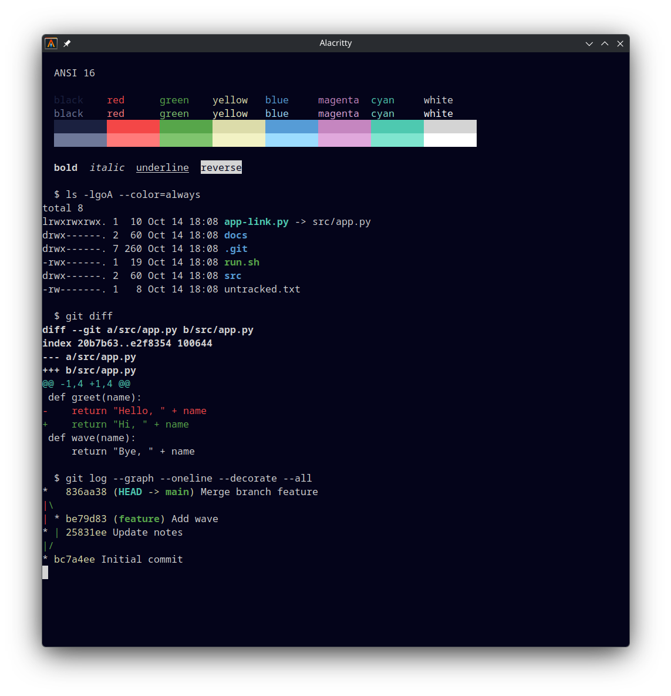

# Deepwick for Alacritty

Deepwick colors for [Alacritty](https://alacritty.org).

> Deepwick is an unofficial theme derived from
> [Polywick Blue](https://vscode.polywickstudio.net) by Polywick Studio (MIT).
> Not affiliated with Polywick Studio.



## Install

```sh
mkdir -p "${XDG_CONFIG_HOME:-$HOME/.config}/alacritty/themes"
cp deepwick.toml "${XDG_CONFIG_HOME:-$HOME/.config}/alacritty/themes/"
```

## Activate

Add the theme to the `import` list in `alacritty.toml` (relative paths are
resolved from the directory of `alacritty.toml`):

```toml
[general]
import = ["themes/deepwick.toml"]
```

Colors you set in `alacritty.toml` itself still override the theme.

## Notes

- Dim colors are not set; Alacritty derives them from the normal colors.
- Search matches use the selection color; the focused match is Gold.
- Hints are Background text on Blue (first character) and Light Blue (rest).

Tested with Alacritty 0.17.0.

## License

MIT. See [LICENSE](LICENSE).
